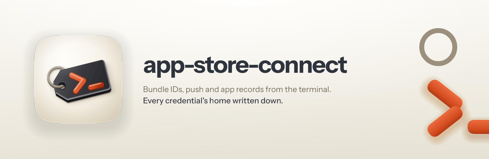
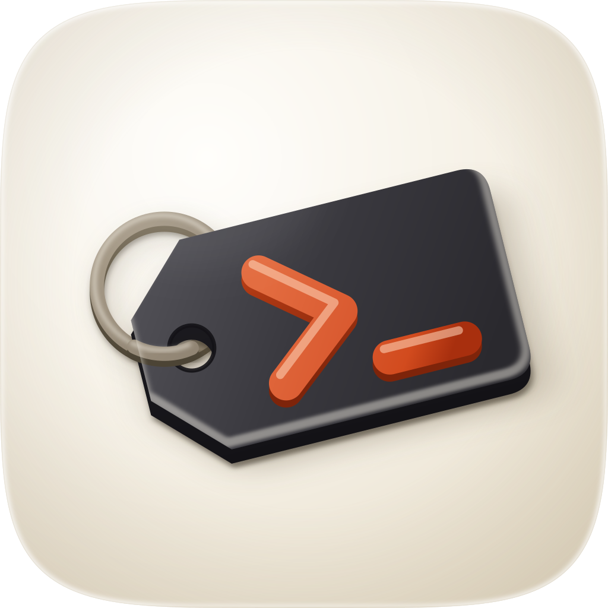

<p align="center">
  
</p>

<h1 align="center"> app-store-connect</h1>

<p align="center"><strong>App Store Connect and the Developer Portal from the terminal.</strong><br />
New bundle IDs, capabilities, push and app records through Rork's <code>asc</code> CLI, with every credential's home written down.</p>

<p align="center">
  
  
  
</p>

---

## Why it exists

I run apps on two Apple teams, Diolog's and my own. Every new app needs the same handful of things set up in Apple's portals, and `asc` 6.2.0 can do nearly all of it. The hard part was never the commands; it was knowing which credential each one uses, and which team it lands on.

That second one bites quietly. asc falls back to a default profile when a command names none, so a command about the other team's app reads or writes the wrong team. Nothing errors.

## What it does

It splits the work into Apple's two lanes and says where each credential lives.

- **API-key lane.** App Store Connect API keys sit in the macOS keychain behind one asc profile per team. Bundle IDs, capabilities, certificates, profiles, builds and TestFlight all go this way, with no human in the loop.
- **Web-session lane.** Creating app records, App Groups, iCloud containers and API keys is refused by Apple's public API, so these sign in as an Apple Account. The two-factor code comes by SMS and asc reads it out of Messages.
- **Warden** holds the rest.

For a new app, `provision-app.sh` finds or creates the bundle ID, reconciles capabilities from the app's `.entitlements` file (push included), and optionally creates the App Store Connect app record. It plans by default with every call read-only, and writes only with `--apply`. Each write is read back by resource ID, and the script stops with exit 3 if the asc profile turns out to point at a different team from the one it expected.

**The skill names no account.** Team IDs, key IDs, Apple Accounts and Warden entry names live in a private folder on the Mac, `~/.config/app-store-connect/`, which the skill reads before its first command. When that folder is missing, it builds it from what asc already knows.

Note: unattended sign-in doesn't work yet on the Mac I built this on. Full Disk Access is fine, so asc can read Messages, but on 2026-11-09 Apple sent the code and it never arrived; not in 50 seconds, and not four minutes later. Text Message Forwarding on the iPhone is the setting that carries it. Until that's on, I sign in once with `! asc web auth login` and the cached session is reused.

## Push keys are the exception

The APNs push key is the one piece Apple exposes to no API at all. There's no App Store Connect endpoint for it, no certificate type, and no asc command. So the skill treats it as a team asset rather than an app asset: one **team-scoped, Sandbox & Production** key per team, created once in the portal, stored in Warden, and reused by every app on that team. The push capability on each bundle ID is still automated.

## What it won't do

- **Retry a failed Apple sign-in.** Repeated failures lock the account, and every attempt texts my phone.
- **Create anything permanent without asking.** A bundle ID or a capability can be undone, so when you ask for the setup it goes ahead with those. An iCloud container can never be deleted, and an app record binds its bundle ID forever and reserves the name, so those wait for a yes.
- **Take a zero exit as proof.** It reads each resource back and reports the ID asc returned.
- **Lift a guard someone else set.** If asc refuses a write because the session is read-only, it says so and stops. In my own evals the run without this skill unset that guard and created a real bundle ID; the run with it didn't.
- **Poke at your browser.** No AppleScript or DevTools snooping on Chrome to hunt for an Apple session; asc can't reuse one anyway.
- **Commit account details.** They stay in the private folder, out of any repo or commit message.

## Using it

Run `/app-store-connect:app-store-connect`, or ask for the thing: "create a bundle ID for com.example.app", "register this app in App Store Connect", "turn on push for the Diolog app".

```bash
scripts/provision-app.sh --team <team> --identifier com.example.app --name "Example" \
  --entitlements Example/Example.entitlements --app-record --sku example-ios    # plan
scripts/provision-app.sh ... --apply                                             # write
```

## What's in the box

| Path | What it is |
| --- | --- |
| `skills/app-store-connect/SKILL.md` | the procedure: accounts, team selection, credentials, sign-in, provisioning, push |
| `skills/app-store-connect/references/accounts-file.md` | the private accounts file's format, and how to build it from asc |
| `skills/app-store-connect/references/new-app.md` | the manual command behind every step, plus App Groups, iCloud and signing |
| `skills/app-store-connect/scripts/provision-app.sh` | plan-then-apply provisioning for a new app |
| `assets/build_icon.py` | the icon generator; `icon.svg` is its output |
| `evals/EVALS.md` | how the skill did against the same tasks with no skill |
