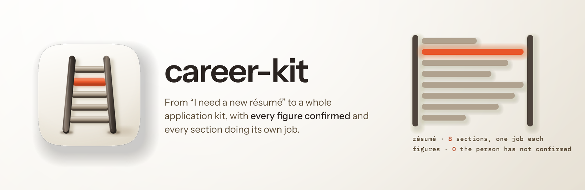

<p align="center">
  
</p>
<h1 align="center"> career-kit</h1>

<p align="center">
  
  
  
  
</p>


Helping someone with their résumé usually goes one of two ways. You spend an evening on a
document that still reads like every other document. Or you hand it to a model, and it gives
you something fluent that quietly claims things the person never did.

This one goes a different way. It reads what they've actually got, researches the country and
the specific employers they're applying to, then builds the set: a review of what they have
now, one résumé per role, their LinkedIn copy, a personal website, an interview guide. All of
it from one file of confirmed facts.

## What it does

**Reads first, asks second.** It wants their LinkedIn export, their current résumé, every job
ad they're going for, and anything else describing their work. It reads all of it before asking
a single question. In the session it was built from, the answers to the first dozen questions
were all in those files.

**Researches the actual employer.** Not résumé advice in general. Which applicant tracking
system that company runs, the words in their current ads, how they interview, what they say
they value. Several independent research runs get reconciled into one digest, and every claim
says which runs supported it. Where two reports disagree, it checks the careers site itself.

**Shows you what's wrong, rather than telling you.** The review comes back as a web page. Every
finding sits above a real cropped picture of their own résumé, with the relevant words
highlighted. You can check it without opening the file.

**Asks the rest in a form they can finish on a phone.** One page, no login. Multiple choice
where the answer is a choice, with a suggested answer already ticked and a note saying where it
came from. Under every text box, three or four example answers they can tap and then edit. It
saves as they go and copies everything out at the end.

That form exists for one reason. A gap in what somebody's told you has to go back to them, not
into the document as plausible-sounding text. An interview panel and a background check test
every number on a résumé, so a figure nobody confirmed costs more than an admitted gap. There's
a script in here that fails the build when an output carries a number the facts file doesn't.

**Builds one résumé per target role, from one set of facts.** Each one mirrors that ad's own
phrases and backs them with a bullet that's true. Same dates, same employer, same figures
across all of them, because they're generated rather than copied. HTML for print, a PDF for
people, a Word file for the portals that parse it. Pages break on their own. Nothing sits in a
fixed-height box that can swallow the last two bullets without saying so.

**Puts real choices to a panel of models.** Photo or no photo, which of three phrasings, does
this section earn its place. Five model families, and half of them read the options in reverse
order, so a first-position preference shows up as a split instead of a consensus. Every brief
and every answer gets saved. Note: the person's own instructions outrank all five reviewers,
every time.

**Leaves a project record.** The facts, the decisions and why, the corrections in the person's
own words, and what's still open. A later session picks it up without anyone repeating
themselves.

## Why it works like this

Everything above came out of one long session building exactly this for one person. Most of the
rules in it are a mistake that session made and then fixed.

Reviewers caught verbs climbing a grade: "shipped" where the truth was "supported", "runs"
where it was "coordinates". A fixed-height page container cut bullets off five résumés at once
and reported no error. Example answers offered in a chat came back as the person's own answer,
word for word. A practice page went live, unlisted, carrying three figures she'd asked to keep
private. Unlisted isn't private; it returned 200 to anyone with the link.

Each of those is now a rule with the reason attached, in `references/evidence.md`.

## The second skill: resume-craft

`career-kit:resume-craft` is the part that knows the document itself. It holds what each of the
eight sections of a résumé is for, with a test for each, the order they go in, and the voice:
first-person paragraphs, past-tense bullets, plain verbs, scope stated exactly. It drafts one
section or a whole résumé from confirmed facts, and it reviews an existing one section by
section without changing it.

Every default is marked as coming from the research in `docs/deep-research/` or from a
correction made during the engagement this plugin came from, and
`skills/resume-craft/references/evidence.md` says which wins where they disagree. A lint,
`skills/resume-craft/scripts/resume_lint.py`, checks structure and voice: section order, summary
length, a count of years, bare present-tense openers, the generic register, gap markers.

The research covers Australian banking in late 2026. The section jobs and the voice travel;
the conventions on length, photos and referees need checking for any other market, and the
skill says so when it is used for one.

## Install

```
/plugin marketplace add fledgeling-co/fledgeling-plugins
/plugin install career-kit@fledgeling-plugins
```

## Using it

Ask for it by name, or just describe the job: "update my résumé", "I'm applying for these
roles", "rewrite my LinkedIn", "help me prepare for this interview".

It works for anyone, in any country, in any industry. The worked example happens to be an
Australian bank, which is where it got built.

Note: it won't publish, deploy, buy a domain or edit a live LinkedIn profile without being
asked. Those are the person's calls, not the agent's.
