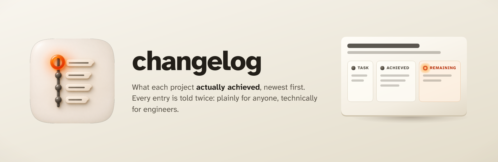
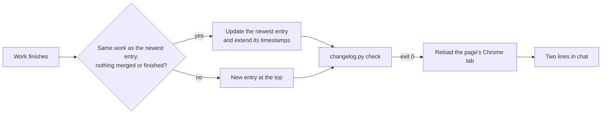

<p align="center">
  
</p>

<h1 align="center">changelog</h1>

<p align="center"><strong>What each project actually achieved, newest first.</strong><br />
A skill for Claude Code that keeps one page per project, adds an entry each time work finishes, and tells every entry twice: plainly for anyone, technically for engineers.</p>

<p align="center">
  
  
  
  
</p>

---

## What it does

When Claude finishes a piece of work, it writes an entry at the top of that project's **`CHANGELOG.html`** and shows you the page. You scroll down and you've got the history: what each piece of work set out to do, what it actually achieved, and what's still left.

A status update in chat is read once and scrolls away. A status page that's overwritten every time only shows today. I wanted the third thing, a record I can scroll back through to see what's genuinely been achieved, and one I can hand to someone who's never seen the code.

## What an entry looks like

Every entry has the same parts, in the same place:

- **A one-line title** stating the outcome, e.g. "Failed deliveries now retry after a server restart".
- **A two-sentence subtitle**: what was achieved, then what it means for someone.
- **A timestamp line**: when it was written, each time it was updated, and when it was last updated.
- **Task, Achieved and Remaining**, side by side as three columns on a desktop screen and stacked on a phone.

Task, Achieved and Remaining are short bullets, 1 to 4 each and 14 words or fewer, so an entry reads at a glance; the title and subtitle carry the story. Each is written twice. The **plain** version is for a founder, customer or investor: everyday words, no file paths, commands or ticket numbers. The **technical** version carries the PR, the counts and a "How we know:" line quoting the command or measurement that proved it. A switch at the top shows one or the other, never both, and remembers your choice. Plain is the default, because the reader who needs it is the one who won't go looking for a switch.

Remaining always ends with anything that's waiting on you: a decision, a credential, a go-ahead. When there's nothing left it says "Nothing remaining." rather than disappearing, so you can see that it's done rather than wonder.

Where a picture explains the change faster than prose (an architecture that moved, a before-and-after number, a new flow), it hands off to `visualization:visualization` and pastes the diagram into the entry.

## Not every report is a new entry

Small progress on the same piece of work updates the newest entry instead of adding a near-duplicate. A new entry starts when something merged or shipped, a round of work finished, a check went from failing to passing (or the reverse), or the title no longer describes the work. Only the newest entry is ever revised; older ones are the record, and they change only to correct a factual error, with a dated note saying so.

## It reloads the tab you already have open

Opening the page afresh after every report stacks duplicate tabs. On 27 Nov 2026 my Chrome had 26 tabs open and 14 of them were the same project's status page. So the skill finds the tab that already has the page and reloads it, through the Chrome DevTools MCP where a project has it and an AppleScript fallback where it doesn't. It only opens a new tab when none has the page, and it never starts a second Chrome.

## How it works



`scripts/changelog.py` does the mechanical parts. `init` creates the page in the repo's main checkout (never a worktree, which disappears when its branch merges). `stamp` prints the current Sydney time with its offset. `check` fails the page on anything structural: entries out of order, a title over 10 words, a subtitle that isn't two sentences of 25 words or fewer, a timestamp without an offset, a missing column or version, a column that isn't 1 to 4 bullets of 14 words or fewer, Remaining disagreeing with its "nothing left" flag, code or ticket numbers in the plain version, leftover template text, or a repeated id.

Note: the checker proves the page is well-formed. It can't tell whether the words are true or whether the plain version is genuinely plain; that's still on whoever wrote the entry.

## Installing

```
/plugin marketplace add fledgeling-co/fledgeling-plugins
/plugin install changelog@fledgeling-plugins
```

Then finish some work in a project and ask how it went, or say "log this". The first time, it creates `CHANGELOG.html` from the template.

## What it doesn't do

- **It doesn't answer "what's left".** That's a question about remaining work, so it gets a short answer in chat, pointing at the newest entry where that helps.
- **It doesn't touch your `CHANGELOG.md`.** Release notes for a package's users are a different document, and the skill leaves them alone.
- **It doesn't delete old status pages.** It replaces `status-update:status-update` for reporting; existing `STATUS.html` files stay where they are.
- **It doesn't write `ARMADA.md`.** That's `armada-sync:armada-sync`'s, and a big piece of work usually wants both.

## Does it actually work?

The mechanics are verified; the claim that it beats writing the report in chat hasn't been tested yet. The checker's self-test breaks the bundled example page in 17 specific ways and confirms each one fails, and confirms a freshly created page passes. The template was rendered in Chromium at desktop and phone widths, light and dark, in both views. No run has compared Claude with this skill against Claude without it. [EVALS.md](EVALS.md) has the detail and the three tasks that would settle it.
