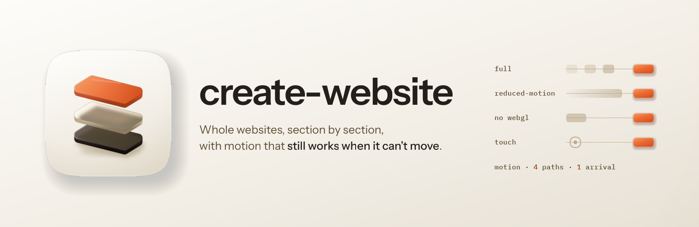

<p align="center">
  
</p>
<h1 align="center"> create-website</h1>

<p align="center">
  
  
  
  
</p>

Ask a model for a website with a video hero and some scroll animation and you'll usually get one. It'll look fine on the laptop it was made on. Then someone opens it with reduced motion switched on and half the page is invisible, or on a phone where the 3D scene never loads, and nobody checked either.

**create-website builds the whole site from a brief, one section at a time, and makes the plain version of every effect work before the fancy one goes on top.** A ceramics studio, a portfolio, a small business, an event. It plans the site, finds a shipped reference for each section, builds it, puts motion through it, makes the hero (an image, a short generated video, or a 3D scene), checks it in a real browser four ways, and only deploys when you say so.

## What it does

**Plans before it lays anything out.** Every section gets a one-line job, a reference, and a motion line that says what happens under reduced motion. It's written to `.create-website/site-plan.json`, and `plan_check.py` fails the plan if a section is missing any of them. That file is what stops a step from quietly not happening.

**Widens the idea before it commits to a look.** One `trawl:trawl` run per site, through design-craft's packet, with three website additions: how the world moves, at most two signature moments, and what the hero is made of. The category's textbook page is written down as the thing it can't pick.

**Takes one shipped reference per section.** It searches Mobbin for each section type, opens the results, and records what it took in measurable terms (element count in the first viewport, the frame, where the focal object sits) and what it left. Adjacent sections take different references, so the page doesn't repeat one layout down its length.

**Builds the plain site first.** Content, navigation and the calls to action go in as plain HTML with still images through `design-craft:design-craft` and `ux-craft:ux-craft`. Motion, video and 3D are added on top, so when one of them fails the page still works.

**Puts motion through every section, with a way out.** CSS scroll-driven animation by default, GSAP only to pin or to drive a 3D scene. Native scrolling stays native. Under reduced motion the effect comes out completely, so nothing is left invisible or pinned, and a looping video gets a pause button.

**Makes a video hero without wasting clips.** Before anything is generated it settles four things: whether it replaces the current hero, where it sits and which edge things enter by, what the page shows when it ends, and the beats with their pauses. Each of those cost a regeneration in the session this came from, where a character hero took 11 billed clips for a cut that used three. Then stills first, the price before the first clip, the running total after each, and `clip_tools.py` to measure joins, the loop seam and flashing on the final file.

**Decides where the 3D comes from.** A rendered still, CSS depth, a three.js scene, or a mesh generator if one's connected (none was when this was written). A real-time scene has to show something a still can't, and it ships with a still fallback, a capped pixel ratio, pausing off-screen and a context-loss handler.

**Checks it the way a visitor meets it.** `scroll_capture.mjs` scrolls through every section in a real browser four times: normally, with reduced motion, with WebGL switched off, and as a phone with touch. It fails on sideways overflow, a crash, a reveal that never fired, or a video that plays under reduced motion. Then `design-review:design-review` runs its contrast and target-size gates.

**Deploys only when you say so, and checks what it served.** An unlisted address with `noindex` is still public, so `deploy_check.py` crawls every path on the origin before the address goes anywhere, checks each video answers Safari's range requests, checks a private site as a stranger with no login, and reports a custom domain's states one at a time. Buying a domain is your money, so it checks availability, price, balance, registrant, owner and the verification email before it offers.

Note: it won't write facts it doesn't have. A missing opening time goes on the page as a marked gap and onto the list of things waiting on you.

## Install

```bash
/plugin marketplace add fledgeling-co/fledgeling-plugins
/plugin install create-website@fledgeling-plugins
```

Then ask for a website: "build me a site for my studio, everything's in notes.md", "a portfolio with a 3D hero that turns as you scroll", "redo my personal site with a short video hero".

## Does it actually work?

Three tasks, each run twice: once with the skill and once with nothing but the model. A website for a ceramics studio from a page of notes with a video hero, a designer's portfolio with a 3D hero, and a request to deploy a site "unlisted" with a private pricing page on it.

**The report card.** An independent grader checked 28 things against what each run left on disk. With the skill: **28 of 28**. Without it: **11 of 28**. 17 of those were passed only by the skill and none only by the baseline. The rest both passed, and some of those couldn't fail in a test with no credentials, which `EVALS.md` names.

What the baseline missed was mostly the plain path and the facts. The no-skill portfolio kept rotating under reduced motion and had no fallback when WebGL was missing. It also wrote a designer's clients, quotes and figures as fact under the heading "Measured, not claimed". The no-skill studio site invented an Instagram handle that may belong to someone else.

**The blind taste test.** Five models from four companies compared each pair without being told which was which, then compared them again with the order swapped. On the portfolio and the deploy task, all four judges outside Claude's family picked the skill's version in both orders. On the studio site, GPT and Meta's judges picked the skill in both orders, and both Gemini judges picked whichever site they read second, so those count as position flips rather than votes. No judge picked the no-skill version in both orders.

It isn't free. The skill's runs took about 59% longer and used about 63% more tokens, mostly on the plan, the four capture passes and fixing what they found.

The full tables, the judges' model ids, every caveat and the rules that came out of the judges' findings are in [`EVALS.md`](EVALS.md). Where each rule comes from is in [`references/evidence.md`](skills/create-website/references/evidence.md), and the research behind it is in [`docs/deep-research/`](docs/deep-research/).
