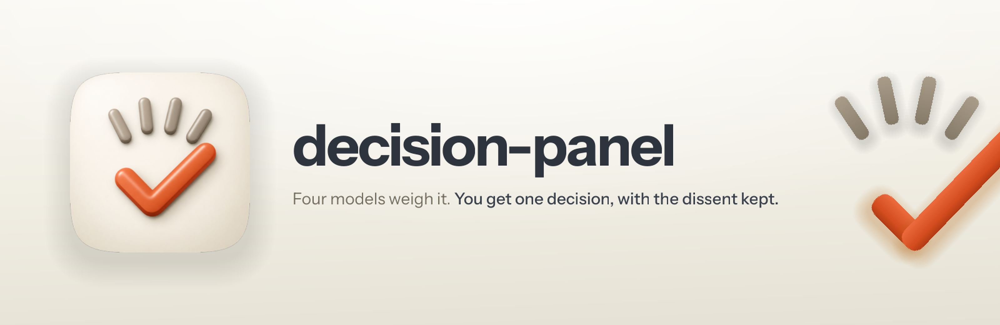

<p align="center">
  
</p>

<h1 align="center"> decision-panel</h1>

<p align="center">
  
  
  
  
</p>

Hand one decision to four model families and get it decided, on one page, with the reasons and the dissent written down.

Some calls deserve more than one model's opinion and less than a meeting: which stack to support first, whether a plan holds up, which of two architectures to commit to. This plugin puts that call to Fable, GPT-6 Astra, Gemini Argon and Grok at once, each on the newest model its CLI offers, and lets the evidence in your repo settle it before any vote does.

It's the deliberate sibling of `clarify`. Clarify refers a fork to one model on its own, mid-task, before deciding whether to bother you. This one only runs when you ask for it, uses all four, runs two rounds and leaves a record.

## How it works

1. **Frames the decision** from the conversation and your repo: one question, two to four options, the constraints and where each came from, and the files a model needs to read. Nothing secret or personal goes into the brief; it points at paths instead.
2. **Round one.** All four answer independently with a `VERDICT` line, a ranking, the evidence and the risk if they're wrong. Two of them read the options in reverse order, because judges favour whatever they read first.
3. **Round two, only on a split.** Positions come back to all four as Reviewer A to D, never by model name. A model that changes its mind has to cite something new, or its first answer stands. If one model cites an outside source the others didn't read, the source is fetched and quoted to all of them first.
4. **Decides.** Evidence first, then the majority, with the minority written down. A tie that survives round two is broken on the evidence and marked as a tie-break.
5. **One page.** A self-contained HTML decision page in `docs/decisions/`: the decision, why, what happens next, every option and who chose it, each model's position, the dissent and the evidence. `scripts/build_decision.py --check` refuses a page that counts a failed model as a vote or hides a dissent.
6. **Acts on it.** It carries out the next steps itself, except anything destructive, irreversible, outward-facing or that costs money, which waits for your OK.

`scripts/tally.py` does the counting, so the settle-or-split call is the same every time: unanimous is decided, three of four is decided with dissent, and anything closer goes to round two.

## Does it actually work?

It's had one live run, and no blind comparison against working without it yet. [EVALS.md](EVALS.md) says what would settle that.

The live run was a real open question from another project: which stack a A$990 app health check should support first. Round one leaned 3 to 1 towards Vite React on Supabase. The one dissenter, GPT-6 Astra, pointed at vendor documentation the others hadn't read, saying that stack is no longer what Lovable or Bolt build by default. Fetched and checked, the documentation agreed. Quoted to all four in round two, it moved every one of them off that option.

Round two then split 2 to 2, and the tie went to Next.js on Vercel with Supabase. The tie-break rested on the plan's own calibration rule, and the page says so, with both dissents kept.

The same run found a bug in the skill. Grok put a sentence of preamble on the same line as its verdict, and the first version of the tally counted it as a failed model. That's fixed, and the fix is in the changelog.

## Installing

```text
/plugin marketplace add fledgeling-co/fledgeling-plugins
/plugin install decision-panel@fledgeling-plugins
```

## Using it

Ask for it: "have the panel decide which queue to use", "put this to the panel", "panel it and just pick one", or `/decision-panel:decision-panel`. You can say what the options are, or let it draft them from the repo.

## What it won't do

- Fire on its own. Quick forks during other work belong to `clarify`.
- Review someone's feedback (`feedback-panel`) or a code diff (`code-review`).
- Count a model that returned nothing, or answered a different project, as a vote.
- Send secrets, credentials, personal data or a client's confidential material to any model.
- Act on anything destructive, outward-facing or paid without asking you.

## Requirements

The `claude`, `codex`, `agy` and `grok` CLIs, signed in. A missing one is reported as a failed lane and the panel goes on with the rest. Python 3 for the scripts. Every model runs on your subscriptions, so a run costs no metered money.
