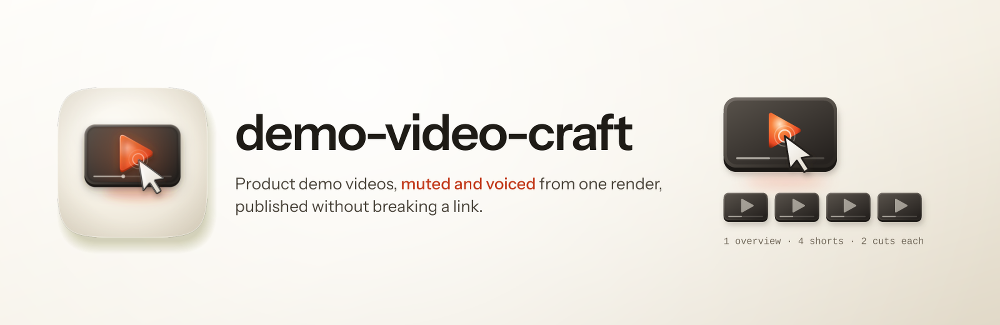

<p align="center">
  
</p>

<h1 align="center"> demo-video-craft</h1>

<p align="center"><strong>A product's demo video series, from brief to a published page.</strong><br />
One overview and a set of shorts, each muted and voiced from a single render, kept in step through every round of notes.</p>

<p align="center">
  
  
  
  
</p>

---

## The problem it solves

Making one good product video is a solved problem; `motion-craft:motion-craft` does that. A **series** is a different job. You need an overview and five to ten shorts that all show the same fictional customer and the same figures, each one with and without a narrator, all of it on a page a prospect can open, and then you need it to survive four rounds of notes from whoever owns the product.

That last part is where it falls over. In the run this skill was built from, the brand lockup got fixed on the pages and stayed wrong in the videos. A corrected voice line kept playing the old reading, because the browser had cached the file under the same name. The share image still showed the first round after the site had been rewritten three times. Every check that ran had passed.

So this skill keeps **one source for each thing that shows up in more than one place**, and it checks the finished files rather than the code that made them.

## What it does

`demo-video-craft:demo-video-craft` runs a series through nine steps, routing each to the skill that already owns it:

1. **Brief and claims.** It reads the product's own record first and writes down what is actually built. Anything unbuilt stays off screen. It picks one fictional company, checks the name and ticker are free on the exchange's register, and reuses its people and figures on every screen.
2. **Plan with motion-craft.** Three storylines for the overview and one shared grammar for the shorts, all in a single film table with a **pace factor** and a **label switch** built in from the start. Owners change both, and in the source run one went from "pick up the pace" to "very fast, hard to keep track" in two rounds.
3. **Words** through the brand's own voice skill: second person, outcome first, at most 130 spoken words for the overview and one line of 24-34 words per short.
4. **Picture first.** Scenes are timed to the picture and the narration is placed afterwards, so one render serves both cuts. When the product lives inside another app (a Claude or ChatGPT connector, say), the films stay inside a lookalike of that app, with the product's own screens rebuilt as live HTML so the camera can push in 3x and stay sharp.
5. **Voice and music** from ElevenLabs through Vercel AI Gateway. **Respellings** change only what the voice is sent, never the captions or the pages, so a name said as "Clawd" is still written "Claude". The music bed ducks under the voice by about 11 dB.
6. **Render once, remux, gate.** The voiced cut is the muted master with its audio swapped, never a second render.
7. **Publish** a small video site: an overview page, a shorts modal that grows from its thumbnail, and **permanent file names** with a content hash on every URL, so a republish never breaks a shared link or serves a stale copy.
8. **Report**, including what nobody checked. Loudness numbers are not a listen.
9. **Rounds.** Read every queued note before rendering, search the whole series for the exact words a note quotes, and when the owner says something is still wrong, look for the second place it lives.

## The four checks it ships with

Each is a Python script with `--self-test`, which builds its own fixtures and proves the check fails on a known-bad case.

| Script | What it checks |
|---|---|
| `delivery.py check` | Every film has both cuts, both share one picture (an MD5 of the video stream), both master at -14 LUFS ±0.5 with true peak at or below -1 dBTP, and no published file name has gone |
| `site_urls.py check` | Every video, poster and share-image reference on every page carries `?v=` and the hash of the file now on disk |
| `gateway_audio.py` | Narration, word timings and music through the gateway, with respellings applied in order and the cost printed before you spend more |
| `duck.py` | The music bed's gain curve under the narration |

## Does it actually work?

**No comparison against working without the skill has been run.** For this release the owner chose mechanical checks only, so there is no blind taste test and no report card yet. What has been verified:

- All four self-tests pass, 24 cases between them. Run `evals/run_mechanical.sh` to repeat it.
- `delivery.py check` on the source run's finished files: **PASS 10/10**, every pair sharing one picture, every file at -14.0 LUFS with true peak between -1.1 and -2.6 dBTP.
- `site_urls.py check` on the source run's live site found **3 stale references** nobody had noticed: the share image on two pages and the menu page's poster, all carrying no hash after their files had been replaced. After the fix it reads 70 of 70 current.
- Writing `duck.py` found a bug in the source run's own mixing logic: when two narration lines sat less than about 0.9 s apart, the bed crept back up under the first one. The script merges those dips, and a self-test case holds it there.

The source run was a real one: an AI connector that works inside Claude and ChatGPT, made for one US advisory firm over four rounds on 24-25 November 2026, ending with a 1:41 overview and nine shorts of 21-25 s. `evals/evals.json` carries the four prompts that would settle the open question. [EVALS.md](EVALS.md) has the detail.

## What it won't do without asking

It shows the cost of every paid voice and music call and waits for a yes. It never publishes or deploys without your authorization, never prints the gateway key, and never pushes a repository.

## Install

```text
/plugin marketplace add fledgeling-co/fledgeling-plugins
/plugin install demo-video-craft@fledgeling-plugins
/plugin install motion-craft@fledgeling-plugins
```

Needs motion-craft (it renders through motion-craft's HyperFrames wrapper and sound engine), plus Node, ffmpeg and Python 3, and a Vercel AI Gateway key in `AI_GATEWAY_API_KEY` for the voice and music.

## References

- [`skills/demo-video-craft/SKILL.md`](skills/demo-video-craft/SKILL.md): the procedure and the numbers that bind.
- [`references/brief-and-claims.md`](skills/demo-video-craft/references/brief-and-claims.md), [`picture.md`](skills/demo-video-craft/references/picture.md), [`voice-and-music.md`](skills/demo-video-craft/references/voice-and-music.md), [`site.md`](skills/demo-video-craft/references/site.md), [`rounds.md`](skills/demo-video-craft/references/rounds.md): the depth, one file per job.
- [`references/evidence.md`](skills/demo-video-craft/references/evidence.md): where each rule comes from, from the source run and from motion-craft's study of 48 shipped SaaS product films.
