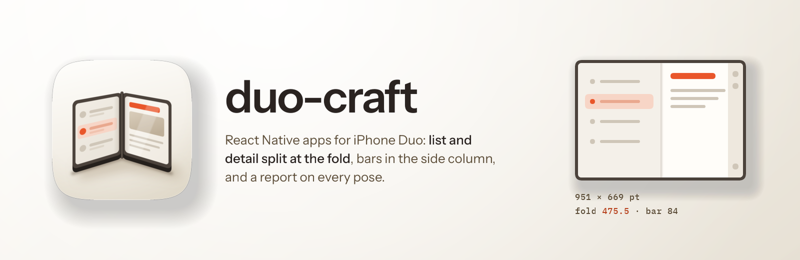

<p align="center">
  
</p>
<h1 align="center"> duo-craft</h1>
Make a React Native app look right on iPhone Duo, and say which poses you actually saw.

<p align="center">
  
  
  
  
</p>

iPhone Duo is an iPhone to every API that names a device. `Platform.isPad` says no and `expo-device` says phone, so a React Native app runs on it unchanged and looks wrong in ways only the Duo shows. The bars stand down one side and take **84pt off that side only**. The open display is **951 by 669 points with the fold at 475.5**, so a phone column stretched across it puts a card over the hinge. Split View hands the left app a half whose side bar is on its *left*. And an Expo SDK 57 app built with the iOS 27 SDK doesn't reach its first screen at all; it crashes at launch, every time.

React Native has no fold API of its own. The fold libraries on npm are weeks old, and the one you're most likely to find, `react-native-nitro-hinge`, has its fold path compiled out unless you set a build flag. Install it as it comes and the fold code is never compiled into your app, and nothing warns you.

## What it does

The skill carries the code rather than describing it. It came out of adapting a shipping Expo app to the Duo; the fold module, the two-pane split and the starter all ran on the Xcode 27.1 Duo simulator before they went in.

- **A fold module the app owns.** About 150 lines of Swift reading Apple's `reservedRegions` and `UIHingeInteraction`. It needs the iOS 27.1 SDK and fails to compile without it, so it can't quietly report no fold.
- **List and detail on the open display.** `DetailPaneLayout` keeps your list on the left, in a fixed 320-point column while the Duo lies flat and at the fold once it folds like a book, and renders what it would have pushed on the right, selects the first item so the right half is never blank, and pushes the chosen item full screen when the device closes. It splits on iPad and wide windows too, once the pane is 900 points wide.
- **Bars that can move to the side.** `NativeTabs` and `Stack.Toolbar` items, because a tab bar or header drawn in a `View` stays where it was drawn, across your content.
- **Insets per side, titles that clear the top.** Each edge pads for its own inset, and titles sit at 59 + 8pt when the top inset is 0. The app this came from was told 20pt was still touching the edge.
- **The launch crash, fixed Expo's way.** On SDK 57 it turns on `expo-build-properties` with `ios.enableSceneSupport`, which is Expo's own opt-in.
- **An audit before anything changes.** `duo_audit.py` runs 13 checks for the assumptions that break on a foldable (a stale `Dimensions.get`, symmetric insets, branching on the device model, a locked orientation, no scene delegate) and prints `file:line` for each.
- **A starter.** One command turns a fresh `create-expo-app` into a two-pane app with native tabs and a toolbar.
- **What shipping apps do on the device.** 313 screenshots of 38 apps on a real iPhone Duo, read frame by frame and checked against the pixels, give the layout rules their numbers: where the split keyboard's top edge sits (y 391 open), how wide a sheet opens (653 points, centred on the fold), where bar buttons land, and how wide rows and text run. One finding changed the template: on the flat open display, 21 apps keep the list in a fixed column near 320 points rather than splitting at the fold, so `DetailPaneLayout` now does too.

Then it builds with Xcode 27.1 and reports all nine poses (closed, open in both orientations, book, tabletop, both Split View halves, picture in picture) as **seen**, **not reached** or **not built**. A pose marked seen has a screenshot behind it that was opened and read.

## Does it actually work?

Four tasks ran twice each, once with the skill and once with nothing. Three model families then judged each pair blind, in both orders.

**Report card.** 29 checkable properties across the four tasks. With the skill: **28 of 29**. Without: **19 of 29**. The gap is where you'd expect it. Without the skill, neither run gave the app a fold signal, the new app shipped locked to portrait with no fix for the launch crash, and the adapted app kept its JavaScript tab bar and hand-drawn header buttons, which can't move into the side bar.

**Blind taste test.** GPT, Grok and Gemini each picked the skill's version of the two build tasks (adapting an existing app, starting a new one), three for three, in both orders.

It lost the crash-fix task, and that's worth saying plainly. The no-skill run found Expo's official `enableSceneSupport` flag; the skill had shipped its own config plugin making the same three edits. It was measured on the Duo the same day (prebuild, Release build, launch, two-pane split showing), and the skill now uses it. Three more rounds closed most of the rest of the gap (a regression check, a tighter report), ending at one loss and two splits; on a well-documented crash a strong model finds the fix without help. On the "should I use nitro-hinge?" question the first answer ran to 44 lines with asides; by the third round it was 31 lines and two of the three judges preferred it in both orders. [EVALS.md](EVALS.md) has the tables, the judges' reasons and the re-runs.

Note: tabletop and the book pose with the hinge partly closed have since been seen running on the Duo simulator. Both Split View halves and picture in picture are built and unit-tested but haven't been seen, because the simulator's Device Hub has no control for either. The skill tells the run to mark them `not reached` rather than assume them.

## What it costs

On the adapt task the skill's run took about 20 minutes and 277k tokens against the baseline's 6 minutes and 136k, mostly spent mocking nine poses in HTML that no one was there to review. The mock now only happens when someone will look at it.

It needs **Xcode 27.1** and the iOS 27.1 simulator runtime to build and look; without them it does the code, typechecks it, and reports every pose as not built. It sets `DEVELOPER_DIR` per command and leaves `xcode-select` alone.

## Install

```text
/plugin marketplace add fledgeling-co/fledgeling-plugins
/plugin install duo-craft@fledgeling-plugins
```

## Getting started

```bash
python3 scripts/duo_audit.py <app-root>
python3 scripts/install_templates.py <app-root>             # adapt an existing app
python3 scripts/install_templates.py <app-root> --starter   # a fresh create-expo-app
```

The skill fires on its own when an Expo or React Native app needs to work on iPhone Duo. `references/simulator.md` covers building against Xcode 27.1 without switching the machine's Xcode, capturing each display, and the Device Hub fix for an empty device list.
