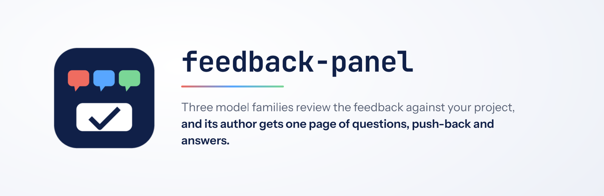

  

# feedback-panel

Review a stakeholder's feedback on a project with a panel of model families, then hand the
person who wrote it one HTML page to answer.

## What it does

1. Grounds every feedback point in the repo and sorts it into understood, question or push-back,
   with a `file:line` for each.
2. Has a second model family check that triage, then runs three families in two rounds on the
   open questions and push-back, and reconciles where they split.
3. Runs the design, UX and design-review skills over decisions that change what a visitor sees.
4. Builds a self-contained report (`scripts/build_report.py`): multiple-choice questions that
   start on a recommended or default answer, the reasoning inside each question, who each
   question is for, the push-back, and a JSON export.
5. Builds what needs no answer, then the defaults, when asked.
6. Reads the exported answers back, asks two families how to implement the ones that differ,
   builds them, and turns the report into a record of the answers with the push-back kept.

Invoke it with `/feedback-panel:feedback-panel`, or ask to have feedback reviewed, challenged or
turned into questions.

## What it does not do

- Review code diffs (`code-review:code-review`) or a project's own backlog
  (`whats-left:whats-left`).
- Deploy, publish or message the feedback author without asking.
- Count a lane that returned nothing, or answered a different project, as a vote.

## Requirements

The lanes call the `claude`, `codex`, `agy` and `grok` CLIs (`scripts/run_panel.sh`); any
missing CLI is reported as a failed lane and the panel continues with the rest. The report
builder needs Python 3 only.
