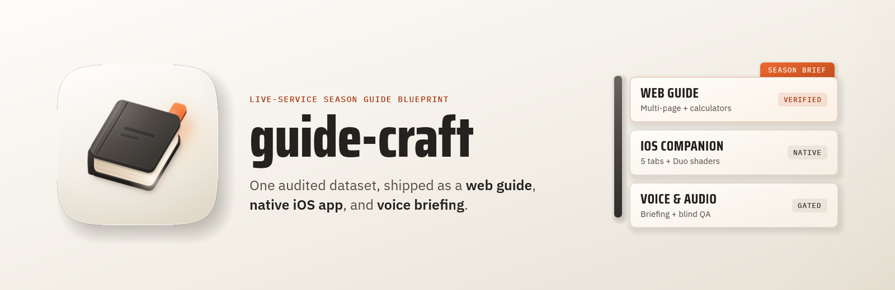
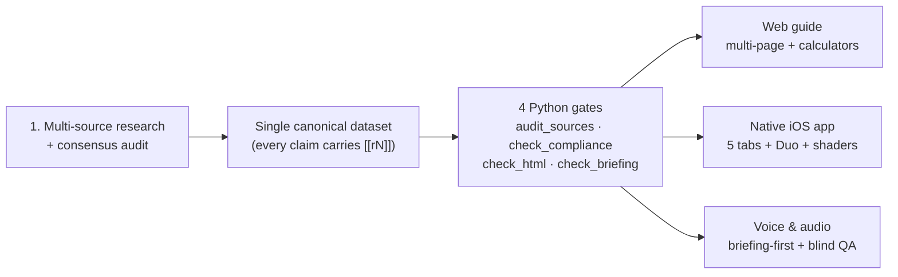

<p align="center">
  
</p>
<h1 align="center"> guide-craft</h1>

<p align="center">
  
  
  
  
  
</p>

Ask a model for a season guide to a live-service game and you'll usually get a flat tier list with ten stale links and a few guessed patch numbers. Ask it to ship an iOS app and a voice guide beside the site, and the three surfaces drift apart by the second edit. Worse, put a publisher's trademark in the app name or bake an official API key into the Swift binary, and Apple rejects the build or the publisher pulls your access on launch day.

**guide-craft builds a multi-page web guide, a native SwiftUI iOS app, and a briefing-first voice assistant from one audited dataset.** It started as the pipeline behind the MW4 Season 1 Field Guide across web, iOS, and live voice. We then widened it across eight game genres (shooters, MOBAs, fighting games, CCGs, ARPGs, MMOs, extraction shooters, and sim racing) using a three-family research pass on publisher APIs, stats bias, and store rules.



## What it does

**Separates live patch facts from stale model weights.** Before any page gets written, `references/research-playbook.md` pulls primary patch notes, creator transcripts, and third-party frame tests. It scores picks by independent publisher count rather than echoed clicks. `scripts/audit_sources.py` checks that every `[[rN]]` link resolves, fails bare domains with no real path, merges syndicated copies of the same author, and computes 95% Wilson lower bounds so small-sample fluke win rates don't top the list.

**Picks the right data tier instead of scraping everything.** `references/cross-genre-apis-and-compliance.md` routes each title to one of four lanes. Where a publisher runs a public API (Riot, Battle.net, Bungie, Steam, Path of Exile, Wargaming, PUBG, iRacing), keys stay on a backend proxy with the publisher's cache and rate rules enforced; they never sit inside an iOS binary. Where the genre uses local strings or UDP streams (Hearthstone deckstrings, PoB XML, PoE2 `.build` JSON, WoW talent strings, CoD Gunsmith codes, F1 25 UDP port 20777), it decodes them on the device. Fighting games query MediaWiki Cargo frame wikis (`action=cargoquery`). Closed games (CoD, Apex, non-whitelisted EA FC) stay clean-room editorial plus lab tests.

**Fixes the stats traps that wreck naive meta trackers.** Raw high-rank win rates skew up by 4 to 15 points because winning players promote into the tier mid-window (Lolalytics GM+ averages 54.14%, cross-tier 69.71%). The playbook requires pre-match lobby tiers or tier-mean subtraction (`WR - Tier Mean`). It also splits rows by `(client_version, balance_hotfix_timestamp)` for unversioned server hotfixes, flags PC opt-in tracker skew (like 17Lands at ~55.4%), and keeps datamined figures separate from frame-by-frame lab counts.

**Checks App Store and publisher rules before build time.** Apple Guideline 4.1(c) bars third-party game brands from your app name and icon, 4.2 rejects thin WebView wrappers, and 5.2 requires original art and publisher ToS compliance. `scripts/check_compliance.py` checks those rules plus nine publisher red lines: Riot's no-memory-read, no-overlay-ads, and no-TFT-Augment-win-rate rules; Capcom's non-commercial cap and hitbox-viewer takedowns; Bungie's no-ads rule; Valve and Blizzard's non-commercial limits; and Wargaming, GGG, and iRacing's required attribution lines.

**Drives all three surfaces from one source of truth.** `references/page-and-app-blueprints.md` writes multi-page HTML guides with genre calculators (TTK tools, sensitivity converters, frame-trap tables, deck or build importers) and exports an additive-only `guide.json` for a five-tab SwiftUI app with foldable iPhone Duo layouts. `scripts/check_html.py` catches nested anchors, digit-starting DOM IDs, broken `#fragment` links, and stray unescaped `<` text before anything ships.

**Adds bespoke visual polish and voice without blowing the budget.** `references/polish-and-ship-playbook.md` covers Canvas and Metal shaders that respect `prefers-reduced-motion`. For voice, it skips dumping raw JSON into an LLM and builds a compact plain-text briefing checked by `scripts/check_briefing.py` (byte cap and entity retention). It enforces session minute caps on paid voice endpoints and transcribes generated TTS audio back through Scribe so you don't ship garbled callouts blind.

Note on limits: this skill won't bypass anti-cheat, read process memory, or scrape behind logins. When a publisher locks its API down, it stops at clean-room editorial notes and lab provenance rather than promising live match sync it can't legally ship.

## Install

```bash
/plugin marketplace add fledgeling-co/fledgeling-plugins
/plugin install guide-craft@fledgeling-plugins
```

Then ask for a guide: "build a Season 2 web guide and iOS app for Battlefield 6 with a TTK calculator", "design a Street Fighter 6 frame-data guide backed by SuperCombo Cargo queries inside Capcom's IP rules", or "build a TFT Set 16 meta site and voice briefing from Riot's API".

## Does it actually work?

**Live with-skill versus no-skill A/B runs haven't been run yet.** During Phase 0 of building this plugin, we chose to self-test the four Python gate scripts and skip live A/B agent runs for v1.0.0. Here's what's actually proved on disk and what isn't.

**The gate scripts are verified.** All four scripts run on standard Python 3 with zero external packages and pass `--self-test` (exit `0`) on clean and deliberately broken fixtures. `check_html.py` catches 4 of 4 HTML faults; `audit_sources.py` catches 6 of 6 citation and stats faults; `check_briefing.py` catches byte overflow, dropped entities, and zero-denominator caps; and `check_compliance.py` catches 9 Capcom IP and ad faults plus a Bungie ad fault while passing a clean Riot manifest.

**The rules trace to real runs and three-family research.** Every layout, voice, shader, and citation rule comes from either measured MW4 Season 1 production bugs (`references/evidence.md`, `O1` to `O11`) or a three-family Deep Research pass across Gemini, Perplexity, and xAI (`docs/deep-research/`, checked with `research_verify_citations`).

**What isn't proved yet.** We haven't run a cold agent with `guide-craft` against a bare model on the seven prompts in `evals/evals.json`, and we haven't measured the extra time or token cost under blind cross-family judging.

The mechanical self-test log, citation checks, exact spend (`$3.20` research plus three icon generations), and the seven eval tasks ready to run are in [`EVALS.md`](EVALS.md). The empirical notes live in [`references/evidence.md`](skills/guide-craft/references/evidence.md) and [`docs/deep-research/`](docs/deep-research/).
