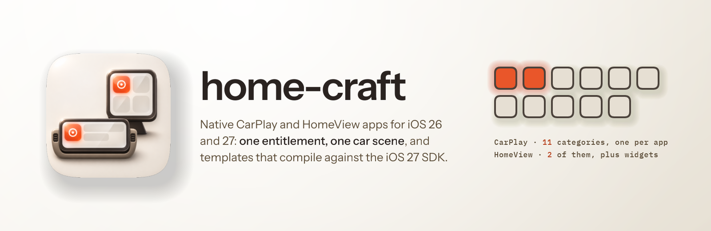

<p align="center">
  
</p>
<h1 align="center"> home-craft</h1>
Put a native iOS app in the car and on Apple's new countertop display, and say which of the two you actually saw it running on.

<p align="center">
  
  
  
  
</p>

Apple HomeView went on sale on 13 November 2026 with **no SDK, no App Store and no simulator**. An app gets onto it two ways, and both start on a paired iPhone: as a CarPlay app holding the **audio or video** entitlement, which HomeView draws unchanged, or as a **small widget**. So building for HomeView is building for CarPlay, and CarPlay changed a lot in iOS 26.4 and iOS 27: a voice-assistant category, a video category, voice overlays, a MiniPlayer, and a rule that an app may hold only **one CarPlay entitlement** (EV charging plus fueling is the one exception).

That last rule catches people. WWDC26 told media apps to ship the audio and video entitlements together; Apple's October 2026 developer guide and both entitlement pages forbid it. The car also launches your app with only the car scene connected, so anything the car needs that lives inside a SwiftUI view simply isn't there, and the phone is usually locked in a pocket while it runs.

## What it does

home-craft carries the code rather than describing it, for native Swift and SwiftUI. It doesn't cover React Native, Expo or Android Auto.

- **Picks the one entitlement.** Audio for media (including video with sound, over AirPlay), video for video-first apps, voice-based conversation for an assistant, or the category the app's real job matches. It never requests one just to reach HomeView, and it tells you when the honest answer is a widget.
- **Wires the car scene for a car-only cold launch.** Scene routing from a SwiftUI app, shared services started at launch rather than in a view, and Now Playing published from **one** framework, because Apple documents mixing MediaPlayer with iOS 27's new NowPlaying framework as undefined behaviour.
- **Swift templates that compile.** An audio and video scene, a voice-assistant scene with the voice template presented on iOS 26.4 and overlaid on iOS 27, a playback service, and the widget every app gets on HomeView. They **type-check against the iOS 27.1 SDK at deployment targets 26.0 and 27.0 under Swift 6**, so every iOS 27 call sits behind an availability check.
- **An audit before anything ships.** `home_audit.py` runs **24 rules** over a project: two CarPlay entitlements in one target, a template the category isn't allowed, a car scene nothing routes, MediaPlayer mixed with NowPlaying, car text that tells the driver to pick up the phone, data that can't be read while the phone is locked, and a widget with no removable background, among others. Each finding names the rule behind it.
- **The limits, with the numbers.** Depth per category (5 for audio and video, 3 for fueling and voice, 2 or 3 for driving and food ordering), tab and list limits read at runtime, and which templates each of the 11 categories may use on iOS 26 and on iOS 27.

Then it reports every test lane (the CarPlay Simulator on a USB-connected iPhone, a real head unit, a CarPlay Ultra car, a HomeView on the counter) as **seen**, **not reached** or **not built**. An agent rarely has a car or a HomeView to hand, so most runs say not reached, and that's the point.

## Where the rules come from

Two research rounds through Dossier on 18 November 2026. The second had four members: OpenAI and Gemini deep research, Codex and Grok. Where they disagreed, the rule was settled against Apple's own documentation rather than by majority, and one member turned out wrong on six points Apple's pages decide: whether an iPad can supply apps to HomeView (it can't), whether disfavouring a widget hides it (it doesn't), whether the voice template can be the root, the tab limit, and two categories' template lists. The reports are in [`docs/deep-research/`](docs/deep-research/), and `references/evidence.md` gives each rule its source and how firm it is.

## Does it actually work?

**This hasn't been benchmarked.** No run compared the skill against having no skill, so there's no report card or blind taste test yet. What has been checked is mechanical: the templates type-check at both targets, an availability guard removed on purpose makes that check fail, and the audit passes all 6 of its fixtures, including the skill's own templates as the clean case. [EVALS.md](EVALS.md) lists exactly what ran and the seven tasks that would settle the open question.

## What it costs

No paid calls during a run. Type-checking the templates needs **Xcode 27** with the iOS 27 SDK; without it the skill still writes the code and runs the audit, and says the type-check didn't run. Requesting the CarPlay entitlement and submitting to App Review stay with you, from your Apple Developer account; the skill drafts the justification and stops there.

## Install

```text
/plugin marketplace add fledgeling-co/fledgeling-plugins
/plugin install home-craft@fledgeling-plugins
```

## Getting started

```bash
python3 scripts/home_audit.py <project-dir>        # 24 rules; exit 1 on any error
python3 scripts/home_audit.py --self-test          # the 6 fixtures
scripts/typecheck_templates.sh                     # the templates, iOS 26.0 and 27.0
```

The skill fires on its own when someone wants an app in the car or on HomeView, asks which CarPlay entitlement to request, or hits a car scene that never connects.
