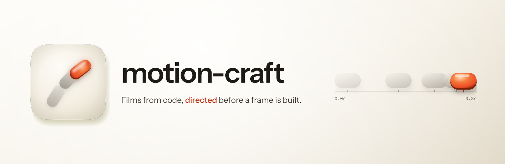

<p align="center">
  
</p>

<h1 align="center"> motion-craft</h1>

<p align="center">
  
  
  
  
</p>

A Claude Code plugin for short films made from code: launch and feature films, explainers, data stories from a spreadsheet, logo stings, lower thirds, vertical social clips and product demos. It renders through [HyperFrames](https://github.com/heygen-com/hyperframes) on your own machine, adds sound from a procedural engine, and hands you an MP4 plus a preview you can keep editing.

I built it because I wanted what Claude Motion does and didn't have access to it. Most of what Claude Motion does well turns out not to be the renderer. It's the directing that happens before the renderer starts, and that part can be written down.

## What it does

Ask for a one-liner like "turn this CSV into a 15 second vertical clip" and most agents produce the same film: a dark or cream background, small type fading up in the middle, every scene entering the same way. Five of the creators I took transcripts from show that film and call it out. This skill moves the decisions forward so that film doesn't get made:

1. **Real material first.** It reads the product, collects the real logo, screens, colours and numbers into `materials/`, and writes down the three to five facts the film has to get across.
2. **Three storylines, then one.** Each differs in device, form and world, and comes with its first two seconds written out. It stops for you to pick unless you've told it not to.
3. **A spec in numbers.** Every adjective becomes a figure, there's a banned-defaults list, a rhythm sheet and a beat map in `timeline.json`. Picture and sound both read that one file.
4. **Hardest shot first**, at full resolution with final type, before the easy scenes get built around it.
5. **Sound** from a vendored copy of claude-motion's stdlib-only Python engine, mastered to −14 LUFS and placed against the same beat map.
6. **Review from frames**, not vibes: HyperFrames' `check` craft findings, contact sheets, a 360 px phone sheet, ranges around every transition, and the measured cuts compared against the rhythm sheet.
7. **Handover**: the MP4, a running Studio preview, and a `REVIEW.md` that says what was measured and what nobody checked.

Edits after delivery go through composition variables and stable element ids, so "make the second number bigger" changes that one element instead of the whole scene.

## The numbers it holds to

A few of the defaults, each with its source in `references/evidence.md`:

| Rule | Default |
|---|---|
| Frame 0 | a poster with the subject in it; the hook lands inside 3 s |
| Reading time | 0.5 s plus 0.3 s a word; the last line holds at least 2 s |
| Type floor | 2.6 % of the frame's short side; cut words before shrinking type |
| Exits | 40-50 % shorter than entrances |
| Transitions | 3-5 kinds a film, each caused by something on screen; at most a third hard cuts |
| Burst | 5-8 cuts in five seconds at 30-60 % of the length, for an energetic film |
| Loudness | −14 LUFS, true peak at or below −1 dBTP |

## What it won't do without asking

HyperFrames runs locally and free. Its sign-in, cloud, publish, share and paid transcription features stay off unless you ask for one by name. `scripts/hf.sh` pins version 0.9.52 and sets `HYPERFRAMES_NO_TELEMETRY=1` and `DO_NOT_TRACK=1` on every call. The skill never posts a film anywhere, and any paid image, video, voice or music generation shows the prompt and the cost first.

## How it was tested

Two briefs, each run with and without the skill, then judged blind by four model families who saw contact sheets without knowing which was which. The first round went against the skill: the plainer films said more, and judges preferred them overall on both briefs, even though the skill's films won on craft. The rules that came out of that loss (every must-carry fact on screen, no empty quarter of the frame, a "does a plain version say more?" review question) are in the skill now. In the second round the data clip won 4-0 and the launch film tied 2-2. On the launch film the plain film still made the stronger case: it showed the problem on screen where mine put a caption on it. That rule went in afterwards and hasn't been tested yet. The full record, including what the assertions can't tell apart, is in [`evals/EVALS.md`](evals/EVALS.md).

## Install

```text
/plugin marketplace add fledgeling-co/fledgeling-plugins
/plugin install motion-craft@fledgeling-plugins
```

Needs Node (for `npx hyperframes`), ffmpeg and Python 3. The first render downloads HyperFrames 0.9.52 and its headless Chrome.

## References

| File | Without it |
|---|---|
| `direction.md` | The film starts as code, so it ends up as the default film |
| `story-and-rhythm.md` | Scenes arrive at the same pace and the payoff lands on nothing |
| `craft.md` | Every element shares one ease, titles get shrunk instead of cut, transitions happen for no reason |
| `formats.md` | A vertical clip gets laid out like a 16:9 film with the sides cropped off |
| `engine.md` | A render comes out differently twice, or silent with no error |
| `sound.md` | Sound gets judged by ear, which the agent doesn't have |
| `review.md` | "Looks good" is reported off a contact sheet that can't show a jump |
| `reference-films.md` | A reference film gets described rather than measured |
| `evidence.md` | Nobody can tell which numbers were measured and which were guessed |

## Credit

The sound engine is vendored from [claude-motion](https://github.com/whaleyxbt/claude-motion) (MIT), with its licence alongside. Craft numbers draw on HyperFrames' own motion-graphics guidance (Apache-2.0), the huashu motion repos, and roughly twenty creator walkthroughs whose transcripts and measured cut timings are recorded in `references/evidence.md`. The engine choice and the testing plan were each settled by a four-family decision panel; both records are in [`docs/decisions/`](../../docs/decisions/) at the repo root.
